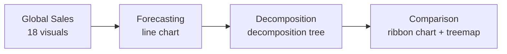

# Global Sales Insights and Forecasting with Power BI

A Power BI report on global sales and profit with forecasting, a decomposition tree and comparison views. It helps track key metrics, compare regions and spot trends.

## Report structure

`Global Sales.pbix` has four pages (read directly from the file):

| Page | What it shows |
|---|---|
| Global Sales | KPI cards, bar charts, donut chart, map and slicers: sales and profit by country, region, category, sub-category, segment and ship mode |
| Forecasting | Line-chart forecast of future sales, based on the last two years of data |
| Decomposition | Decomposition tree for drilling into what drives sales |
| Comparison | Ribbon chart and treemap |

## Highlights

- Sales and profit broken down by country, region, category and sub-category
- Interactive filters by year, month, market and segment
- Geographic view across APAC, Europe, USCA, LATAM and Africa
- Shipment-mode and market comparison
- 6-month forecast window (Jul 2015 to Jan 2016)

## Files

| File | Purpose |
|---|---|
| `Global Sales.pbix` | The main global sales report |
| `sales insights(super_store).pbix` | Superstore sales report with forecasting and comparison pages (also in its own repository) |
| `EDA on Walmart Sales Forecasting.ipynb` | Python EDA of the Superstore dataset (also in its own repository) |

## Open it

Install [Power BI Desktop](https://powerbi.microsoft.com/desktop/) (Windows), download a `.pbix` file and open it.

## Stack

`Power BI` `DAX` `Power Query` `Python (EDA notebook)`
